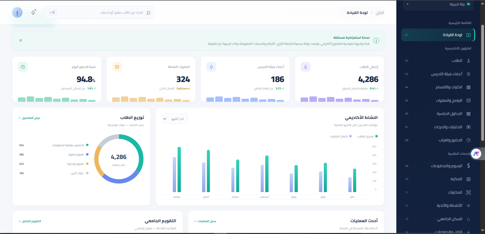
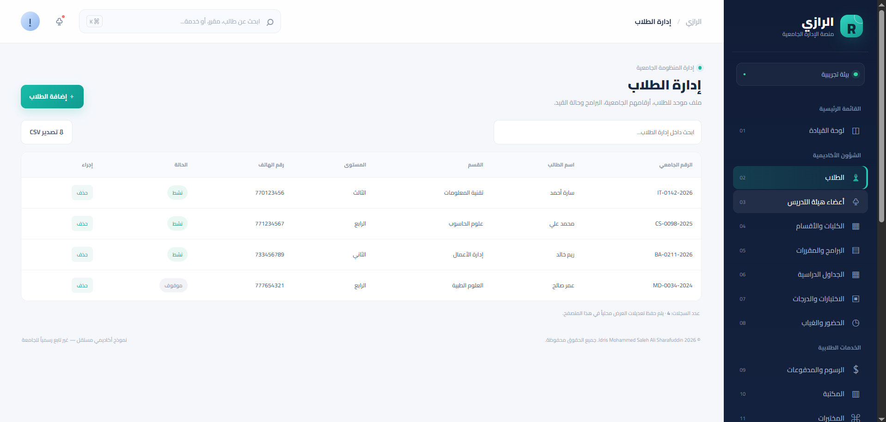
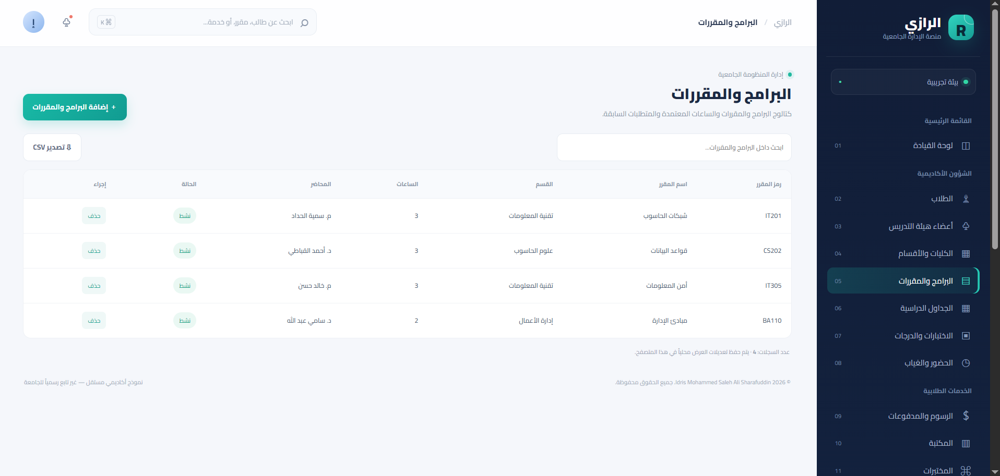

# نظام ولوحة قيادة جامعة الرازي — Al-Razi University Dashboard System

نظام ويب ولوحة قيادة أكاديمية متكاملة بواجهة عربية حديثة (`RTL`) لعرض وإدارة المؤشرات والإحصائيات الأكاديمية، ومتابعة بيانات الطلاب وأعضاء هيئة التدريس والمقررات الدراسية عبر بطاقات إحصائية ورسوم بيانية تفاعلية.

---

## لقطات من النظام

### 1. لوحة القيادة الرئيسية والإحصائيات
تعرض بطاقات المؤشرات الفورية (إجمالي الطلاب، أعضاء هيئة التدريس، المقررات النشطة، ونسبة الحضور اليومي) مع الترحيب والبحث السريع وأزرار إضافة السجلات وتصدير البيانات:



### 2. الرسوم البيانية وتوزيع الطلاب
تعرض الرسوم البيانية التفاعلية للنشاط الأكاديمي وتوزيع الطلاب حسب التخصصات والمراحل الدراسية:



### 3. تفاصيل الأقسام والسجلات الأكاديمية
توضح استعراض البيانات التفصيلية وإدارة السجلات والملفات المرتبطة بالنظام:



---

## شرح تفصيلي لمكونات ومزايا النظام

* **لوحة القيادة الفورية:** توفر نظرة سريعة ومباشرة على أهم الأرقام الأكاديمية في شاشة واحدة منظمة وسهلة القراءة.
* **الرسوم البيانية التحليلية:** تساعد على قراءة النشاط الأكاديمي ونسب التوزيع بشكل بصري واضح ومباشر.
* **إدارة البيانات والعمليات السريعة:** تضم أدوات للبحث السريع، وإضافة سجل جديد، وتصدير البيانات بسهولة.
* **واجهة عربية متكاملة (`RTL`):** تصميم متجاوب ومريح للعين يدعم الاتجاه من اليمين إلى اليسار مع تنسيقات مرتبة.
* **هيكلة مشروع منظمة:** تقسيم واضح بين صفحات الويب، ملفات الأصول والتنسيقات، قاعدة البيانات، والتوثيق.

---

## هيكلية المشروع

```text
alrazi-university-system/
├── assets/          # ملفات التنسيق والسكربتات والوسائط والصور
├── database/        # ملفات وهيكلة قاعدة البيانات
├── docs/            # ملفات التوثيق والشرح
├── index.html       # الصفحة الرئيسية ولوحة القيادة
├── LICENSE          # رخصة الاستخدام
└── README.md        # ملف تعريف وتوثيق المشروع
